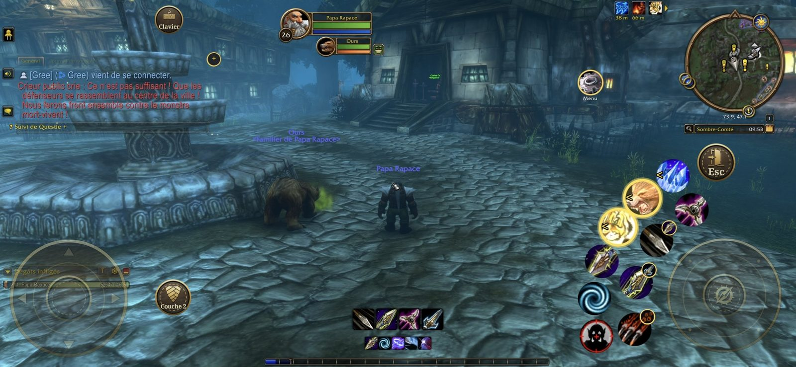
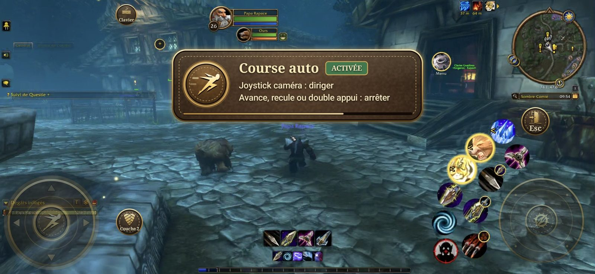
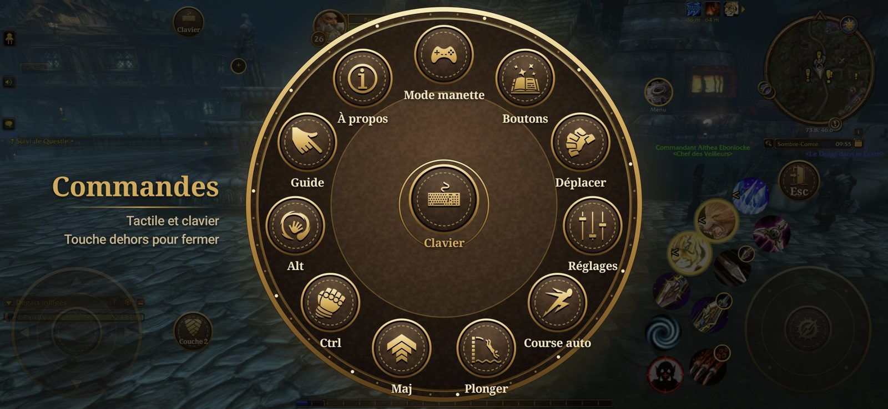

# StreamTouch

**Play World of Warcraft on your Android phone, streamed from your PC, with touch controls made for it.**
Made in Rappace · version 1.0.0 · [Français plus bas](#français)

**New here? Read the [step-by-step guide](GUIDE.md)**: Sunshine on the PC, StreamTouch on the phone, Tailscale to play away
from home, the Magic Packet to turn the PC on remotely, and the WoW addon.

StreamTouch is an Android game-streaming app built on [Moonlight](https://moonlight-stream.org). Your PC runs the game and
[Sunshine](https://github.com/LizardByte/Sunshine); your phone shows the picture and becomes the controller. It is designed to go
with the WoW addon **Streaming Touch 2.5.0**, which adds the spell ring and on-screen helpers inside the game.

## Screenshots

| | |
| --- | --- |
|  |  |
| In game: move stick, camera stick, gold-and-leather buttons | Auto run card |
|  |  |
| Round menu | Swiss PC keyboard with voice typing |
|  |  |
| Settings | Customize buttons (shape, color, icon) |

## Features

| Part | What it does |
| --- | --- |
| Touch controls | Move stick (tap: Use, double tap: auto run), camera stick (tap: target, double tap: jump). The rest of the screen is a mouse: tap = click, hold = right click, drag, two fingers = scroll wheel. |
| Buttons | Esc, Map, Bags, Menu, Target (hold: nearest corpse), Use, Jump / Dive, Keyboard (hold: round menu), Professions, Talents, Layer 2. Each one can be moved, hidden and restyled (shape, color, icon). |
| Look | Medieval gold-and-leather theme: bevelled gold frames, stitched leather, embossed golden RPG icons. |
| Round menu | Controller / touch mode, buttons, move controls, settings, auto run, dive, Shift / Ctrl / Alt for the next press, guide, about. |
| Modes | Touch mode or controller mode (only Esc and Keyboard on screen). Choose which one starts in Settings. |
| Keyboard | Auto: the Swiss PC keyboard of the app when the phone is set to Switzerland, otherwise your phone keyboard in your own language. |
| Languages | English, and French when the phone is in French. Adding a language = translating one text file (`app/src/main/res/values/st_textes.xml`). |

## What you need

- A Windows PC with World of Warcraft and [Sunshine](https://github.com/LizardByte/Sunshine) (or NVIDIA GameStream).
- The WoW addon **Streaming Touch 2.5.0** in `Interface/AddOns` (recommended).
- An Android 8.0 or newer phone (64-bit ARM).

## Install

1. Download `StreamTouch-1.0.0.apk` from the **Releases** page and install it.
2. Open StreamTouch, add your PC and pair it with Sunshine, like any Moonlight client.
3. Start a stream: the touch controls appear over the game. Open the round menu (Menu button, or hold Keyboard) for the guide and settings.

### Optional: Rappace's WoW interface layout

The file [`reglages-wow/disposition-mode-edition.txt`](reglages-wow/disposition-mode-edition.txt) is the Edit Mode layout
(bars, frames, minimap) used with StreamTouch. To use it: copy the whole text, then in WoW press Esc > Edit Mode >
layout menu > **Import**, paste it and give it a name. Nothing changes in your game unless you import it yourself.

### Optional: Rappace's Streaming Touch settings

The addon (version 2.4 or newer) can export and import its settings as text: `/stouch` > **Commands** tab >
**Export my settings** / **Import settings**. The file
[`reglages-wow/streaming-touch-papa-rapace.txt`](reglages-wow/streaming-touch-papa-rapace.txt) holds the settings of Papa Rapace
(spell arc, round menu, chat, bars). Copy the whole text, open **Import settings**, paste it and press **Import**: the
character's Streaming Touch settings are replaced and the interface reloads. On another class, the arc layout is kept and the
spells are the ones suggested for your class. These are also the addon's default settings for a new character.

## WoW addon: Streaming Touch

The addon is in [`addon/StreamingTouch`](addon/StreamingTouch) (MIT license, written from scratch, no other addon needed).
It adds the spell arc around the camera joystick (pages that follow combat, a second layer and stances / forms), the round menu,
the chat placement above the phone keyboard, account profiles and settings export / import.

1. Download `StreamingTouch-2.5.0.zip` from the **Releases** page.
2. Unzip it into `World of Warcraft/_forever_/Interface/AddOns` (or `_retail_`, `_classic_era_`…), so you get `AddOns/StreamingTouch`.
3. Start the game. Settings: minimap button or `/stouch`.

**Putting a spell, a potion or a quest item on the arc:** open the spellbook (or a bag), pick up the spell (or the item) with
your finger and drop it on a button of the arc: it takes that place. Out of combat, 12 buttons per page at most. You can also
choose it in the arc editor (`/stouch`), tab **Macros, sacs** for the items of your bags. Items show how many are left and
their cooldown.

**Tooltips:** keep your finger on a button of the arc to see the game's tooltip (name, rank, cost, description); on the small
golden badge, the spell cast when you hold the button.

## Build from source

Requirements: JDK 17, Android SDK (compileSdk 37) and NDK 29.0.14206865. Clone with submodules (`git clone --recursive`).

```
./gradlew assemblePubliqueDebug          # test build, debug-signed
./gradlew assemblePubliquePublication    # release build, needs your own keystore.properties
```

`keystore.properties` (not in the repository) gives `storeFile`, `storePassword`, `keyAlias` and `keyPassword` of your own key.
Please keep your own application ID if you publish a fork.

## Credits and license

- **StreamTouch** touch layer, round menu, keyboards, theme and settings: written for Rappace (package `com.limelight.wowtouch`).
- **Streaming engine:** Moonlight for Android by Cameron Gutman and contributors, GPL-3.0. The original Moonlight readme is in `README-Moonlight.md`.
- **Icons:** [game-icons.net](https://game-icons.net) by Lorc, Delapouite, Caro Asercion and sbed, CC BY 3.0; gold and relief added by the app.
  The full list of icons and authors is in `app/src/main/assets/wowtouch/licenses/GameIcons-CC-BY-3.0.txt`.
- **App icon:** artwork provided by Rappace.

StreamTouch is free software under the **GNU GPL v3** (see `LICENSE.txt`), like Moonlight it is built on.
It is an unofficial project, not affiliated with Moonlight, game-icons.net or Blizzard Entertainment.
World of Warcraft is a trademark of Blizzard Entertainment.

---

## Français

**Pour commencer, lis le [guide pas à pas](GUIDE-FR.md)** : Sunshine sur le PC, StreamTouch sur le téléphone, Tailscale pour
jouer hors de chez toi, le Magic Packet pour allumer le PC à distance, et l'addon WoW.

**StreamTouch** permet de jouer à World of Warcraft sur un téléphone Android : le PC fait tourner le jeu et
[Sunshine](https://github.com/LizardByte/Sunshine), le téléphone affiche l'image et devient la manette. L'appli est construite sur
[Moonlight](https://moonlight-stream.org) et va avec l'addon WoW **Streaming Touch 2.5.0**.

- **Commandes tactiles** : joystick de déplacement, joystick caméra, l'écran comme une souris, et des boutons que l'on place, cache et habille à son goût.
- **Style or et cuir**, menu rond, guide intégré, mode tactile ou mode manette au choix.
- **Clavier** : le clavier suisse de l'appli en Suisse, sinon le clavier du téléphone dans ta langue.
- **Langues** : français si le téléphone est en français, anglais sinon.

Captures d'écran : voir plus haut (dossier `captures/`).

**Installer :** télécharge `StreamTouch-1.0.0.apk` dans **Releases**, installe-le, ajoute ton PC et associe-le à Sunshine,
puis lance un stream. Le menu rond (bouton Menu, ou maintenir Clavier) donne le guide et les réglages.

**Disposition d'interface WoW (facultatif) :** le fichier [`reglages-wow/disposition-mode-edition.txt`](reglages-wow/disposition-mode-edition.txt)
contient la disposition du Mode Édition (barres, cadres, mini-carte) utilisée avec StreamTouch. Copie tout le texte, puis dans WoW :
Échap > Mode Édition > menu des dispositions > **Importer**, colle-le et donne-lui un nom. Rien ne change dans ton jeu
tant que tu ne l'importes pas toi-même.

**Réglages Streaming Touch de Rappace (facultatif) :** l'addon (2.4 ou plus récent) sait exporter et importer ses réglages en texte :
`/stouch` > onglet **Commandes** > **Exporter mes réglages** / **Importer des réglages**. Le fichier
[`reglages-wow/streaming-touch-papa-rapace.txt`](reglages-wow/streaming-touch-papa-rapace.txt) contient les réglages de Papa Rapace
(arc de sorts, menu rond, chat, barres). Copie tout le texte, ouvre **Importer des réglages**, colle-le et appuie sur **Importer** :
les réglages de Streaming Touch du personnage sont remplacés et l'interface se recharge. Sur une autre classe, la disposition de l'arc
est gardée et les sorts sont ceux conseillés pour ta classe. Ce sont aussi les réglages de base de l'addon pour un nouveau personnage.

**Addon WoW Streaming Touch :** il est dans [`addon/StreamingTouch`](addon/StreamingTouch) (licence MIT, écrit de zéro, aucun autre
addon nécessaire). Télécharge `StreamingTouch-2.5.0.zip` dans **Releases** et dézippe-le dans
`World of Warcraft/_forever_/Interface/AddOns` pour obtenir `AddOns/StreamingTouch`. Réglages : bouton de la mini-carte ou `/stouch`.
Pour mettre un sort, une potion ou un objet de quête sur l'arc : ouvre le grimoire (ou un sac), prends-le avec le doigt et
lâche-le sur un bouton de l'arc (hors combat). Doigt posé sur un bouton : l'infobulle du jeu (nom, rang, description) ; sur le
petit rond doré : le sort lancé au maintien.

Logiciel libre sous licence **GPL v3**, comme Moonlight. Projet non officiel, sans lien avec Blizzard Entertainment.
Made in Rappace.
