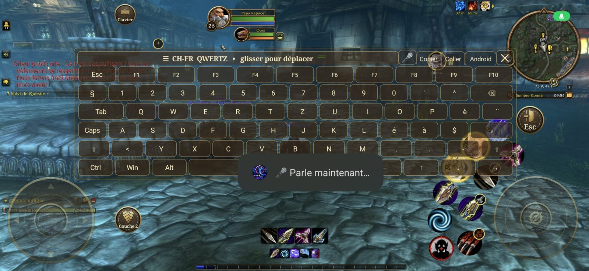
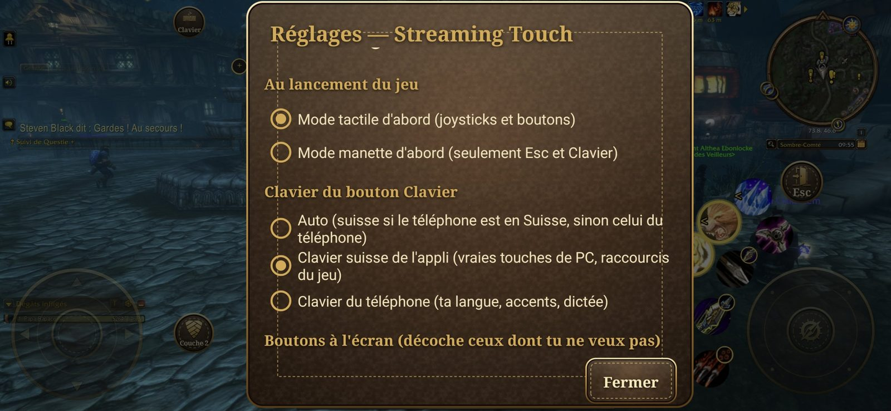
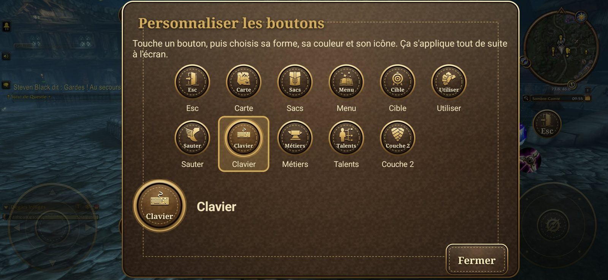

# StreamTouch

**Play World of Warcraft on your Android phone, streamed from your PC, with touch controls made for it.**
Made in Rappace · version 1.0.0 · [Français plus bas](#français)

StreamTouch is an Android game-streaming app built on [Moonlight](https://moonlight-stream.org). Your PC runs the game and
[Sunshine](https://github.com/LizardByte/Sunshine); your phone shows the picture and becomes the controller. It is designed to go
with the WoW addon **Streaming Touch 2.0**, which adds the spell ring and on-screen helpers inside the game.

## Screenshots

| | |
| --- | --- |
|  |  |
| In game: move stick, camera stick, gold-and-leather buttons | Auto run card |
|  |  |
| Round menu | Swiss PC keyboard with voice typing |
|  |  |
| Settings | Customize buttons (shape, color, icon) |

## Features

| Part | What it does |
| --- | --- |
| Touch controls | Move stick (tap: Use, double tap: auto run), camera stick (tap: target, double tap: jump). The rest of the screen is a mouse: tap = click, hold = right click, drag, two fingers = scroll wheel. |
| Buttons | Esc, Map, Bags, Menu, Target (hold: nearest corpse), Use, Jump / Dive, Keyboard (hold: round menu), Professions, Talents, Layer 2. Each one can be moved, hidden and restyled (shape, color, icon). |
| Look | Medieval gold-and-leather theme: bevelled gold frames, stitched leather, embossed golden RPG icons. |
| Round menu | Controller / touch mode, buttons, move controls, settings, auto run, dive, Shift / Ctrl / Alt for the next press, guide, about. |
| Modes | Touch mode or controller mode (only Esc and Keyboard on screen). Choose which one starts in Settings. |
| Keyboard | Auto: the Swiss PC keyboard of the app when the phone is set to Switzerland, otherwise your phone keyboard in your own language. |
| Languages | English, and French when the phone is in French. Adding a language = translating one text file (`app/src/main/res/values/st_textes.xml`). |

## What you need

- A Windows PC with World of Warcraft and [Sunshine](https://github.com/LizardByte/Sunshine) (or NVIDIA GameStream).
- The WoW addon **Streaming Touch 2.0** in `Interface/AddOns` (recommended).
- An Android 8.0 or newer phone (64-bit ARM).

## Install

1. Download `StreamTouch-1.0.0.apk` from the **Releases** page and install it.
2. Open StreamTouch, add your PC and pair it with Sunshine, like any Moonlight client.
3. Start a stream: the touch controls appear over the game. Open the round menu (Menu button, or hold Keyboard) for the guide and settings.

## Build from source

Requirements: JDK 17, Android SDK (compileSdk 37) and NDK 29.0.14206865. Clone with submodules (`git clone --recursive`).

```
./gradlew assemblePubliqueDebug          # test build, debug-signed
./gradlew assemblePubliquePublication    # release build, needs your own keystore.properties
```

`keystore.properties` (not in the repository) gives `storeFile`, `storePassword`, `keyAlias` and `keyPassword` of your own key.
Please keep your own application ID if you publish a fork.

## Credits and license

- **StreamTouch** touch layer, round menu, keyboards, theme and settings: written for Rappace (package `com.limelight.wowtouch`).
- **Streaming engine:** Moonlight for Android by Cameron Gutman and contributors, GPL-3.0. The original Moonlight readme is in `README-Moonlight.md`.
- **Icons:** [game-icons.net](https://game-icons.net) by Lorc, Delapouite, Caro Asercion and sbed, CC BY 3.0; gold and relief added by the app.
  The full list of icons and authors is in `app/src/main/assets/wowtouch/licenses/GameIcons-CC-BY-3.0.txt`.
- **App icon:** artwork provided by Rappace.

StreamTouch is free software under the **GNU GPL v3** (see `LICENSE.txt`), like Moonlight it is built on.
It is an unofficial project, not affiliated with Moonlight, game-icons.net or Blizzard Entertainment.
World of Warcraft is a trademark of Blizzard Entertainment.

---

## Français

**StreamTouch** permet de jouer à World of Warcraft sur un téléphone Android : le PC fait tourner le jeu et
[Sunshine](https://github.com/LizardByte/Sunshine), le téléphone affiche l'image et devient la manette. L'appli est construite sur
[Moonlight](https://moonlight-stream.org) et va avec l'addon WoW **Streaming Touch 2.0**.

- **Commandes tactiles** : joystick de déplacement, joystick caméra, l'écran comme une souris, et des boutons que l'on place, cache et habille à son goût.
- **Style or et cuir**, menu rond, guide intégré, mode tactile ou mode manette au choix.
- **Clavier** : le clavier suisse de l'appli en Suisse, sinon le clavier du téléphone dans ta langue.
- **Langues** : français si le téléphone est en français, anglais sinon.

Captures d'écran : voir plus haut (dossier `captures/`).

**Installer :** télécharge `StreamTouch-1.0.0.apk` dans **Releases**, installe-le, ajoute ton PC et associe-le à Sunshine,
puis lance un stream. Le menu rond (bouton Menu, ou maintenir Clavier) donne le guide et les réglages.

Logiciel libre sous licence **GPL v3**, comme Moonlight. Projet non officiel, sans lien avec Blizzard Entertainment.
Made in Rappace.
